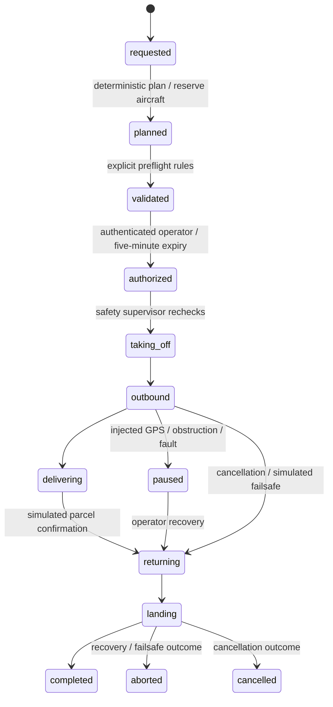

# Mission contract and persistence

The independent `POST /api/v1/flight-plans/preview` operation reads a bounded
QGroundControl file for format/geometry inspection. It does not enter this lifecycle,
create an event, reserve an aircraft or confer authorization. A parsed controller
plan is not accepted as a field of a mission command. The normal deterministic
planner, preflight and separate safety supervisor remain authoritative for every
simulation launch. See [the supported file profile](../../integrations/mavlink/README.md).

The full transition graph in `autonomy/decision_engine/states.py` is authoritative.
Prelaunch cancellation terminates and releases the reservation. Reschedule/replan
invalidates prior authorization. Cancellation during a flight requests virtual return;
it does not teleport an aircraft or claim an immediate delivery.

All mutations authenticate a current user and server role, enforce the user's tenant,
lock the tenant record and check object revision. `Idempotency-Key` commands persist
actor, request digest and response in the same transaction as state/event/audit changes.
Same key/body returns the prior receipt; a different actor/body conflicts. Every mission
transition has a persisted actor, correlation ID, UTC epoch time and reason. UUIDs
identify objects but never authorize access. Simulation worker commands use a distinct
internal actor and deterministic per-tick correlation identity.

Telemetry samples are mode-labelled, ordered per mission and bounded to 600 records.
The worker resumes the persisted phase/tick after restart. SSE holds one bounded
snapshot at a time, yields to network backpressure and renews authorization checks.
A separate read-only capability endpoint exposes state, completion and progress only;
tracking links expire after seven days and are not included in reports or logs.

Route planning uses a local visibility graph and deterministic Dijkstra search. It
minimizes route distance around illustrative restricted circles, selects the feasible
available aircraft with the lowest estimated energy and budgets return plus reserve.
Up to three deterministic waypoint alternatives must satisfy the same geofence,
restriction, payload and energy constraints. Route preference is part of the initial
plan command and its idempotency receipt. A different preference requires release
and replan; previous preflight and authorization are invalidated. Duration includes
both quantized legs and all three 15-second takeoff/delivery/landing phases.

`GET /api/v1/dispatch/preview` sequences up to 25 requested deliveries over up to
50 currently available aircraft; truncation is explicit. The deterministic heuristic
chooses the earliest eligible start, then shortest completion, with stable identifiers
as tie breakers. It budgets each complete round trip, subtracts illustrative energy,
preserves reserve, and adds a 60-second turnaround. Aircraft cannot change depots
within a sequence. Recharge, depot transfers and deadlines are not invented.
The authenticated tenant-scoped preview is read-only and rate-limited to six per
user per minute. It reserves nothing; every chosen assignment is rechecked by the
normal transactional plan and launch commands. This sequences separate round trips;
multi-stop flights and globally optimal vehicle routing remain separate development.
Fixed-wing dispatch is refused pending a runway/release model.
